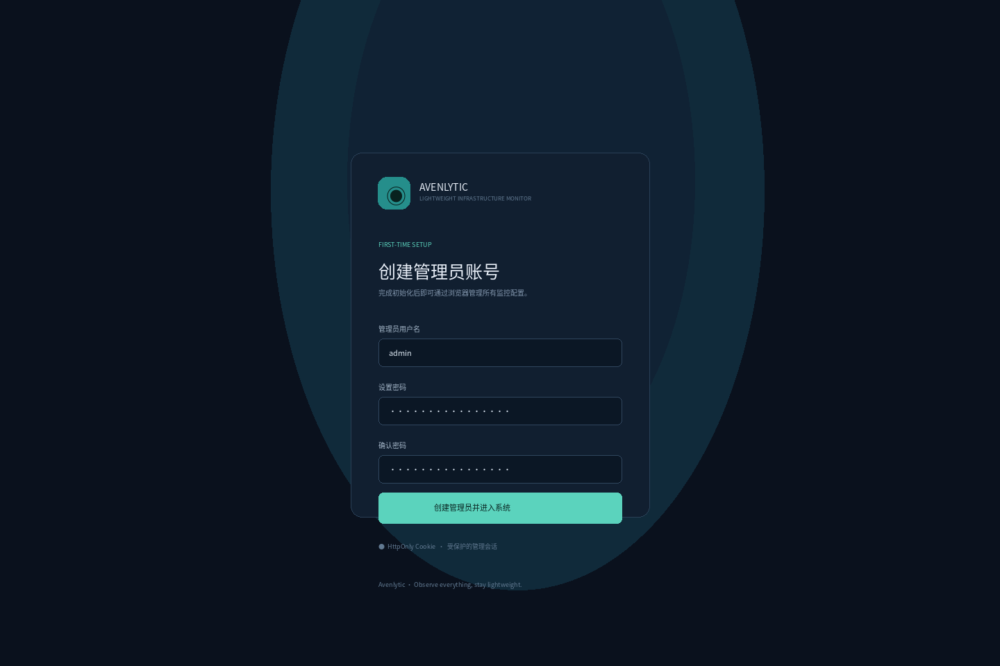
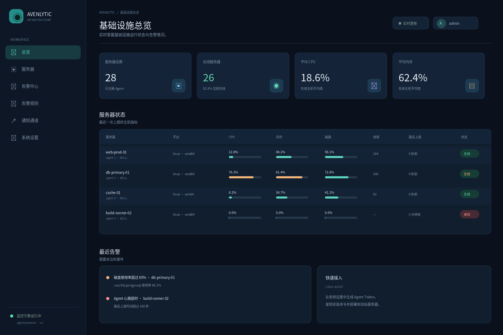
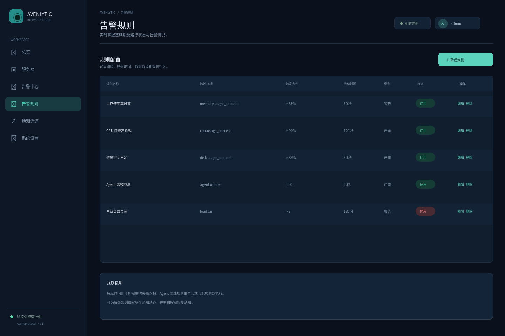
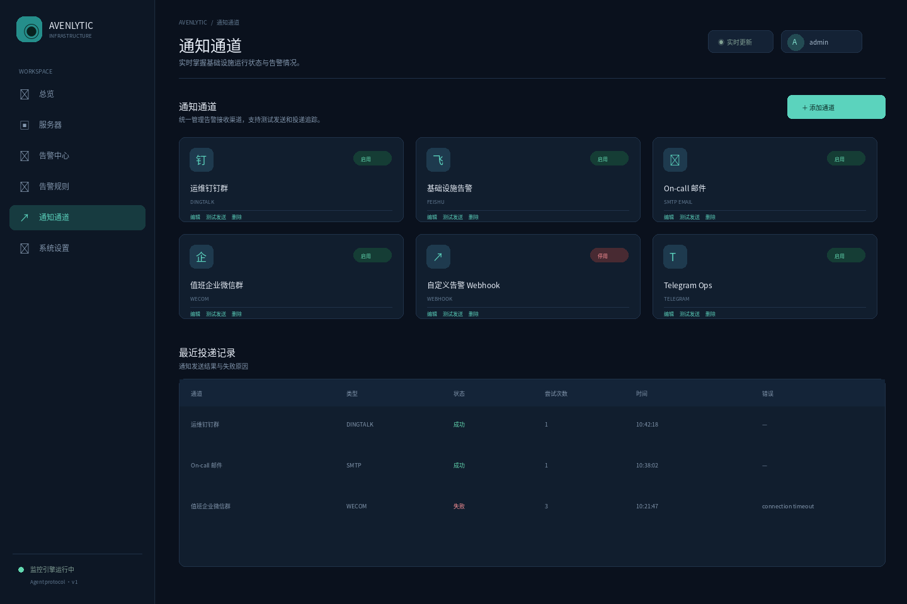
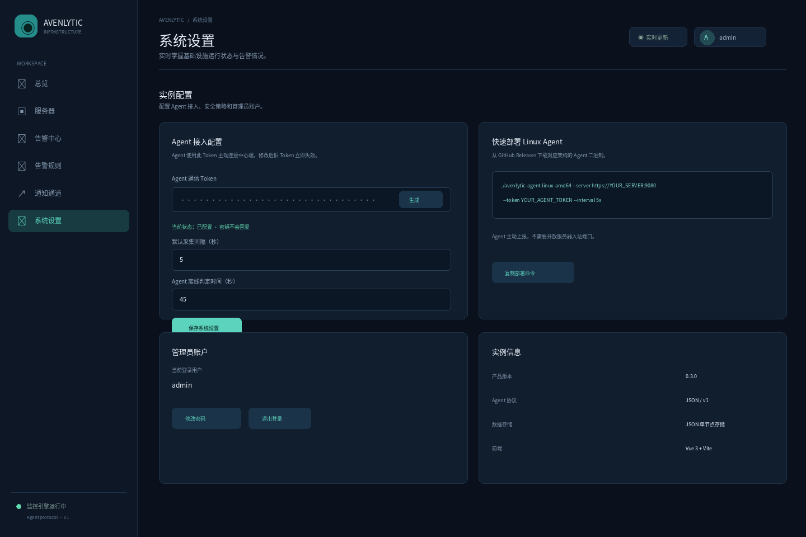

# Avenlytic

[简体中文文档](README.zh-CN.md)

**Lightweight, modular, cross-platform infrastructure monitoring.**

Avenlytic is a Go-based host monitoring system designed around a small outbound-only agent, a central management server, a web console, and replaceable platform adapters and notification channels.

> **Name:** “Avenlytic” is a coined product name, not a standard English dictionary word. It is intended to evoke *analytics* and infrastructure visibility. A quick exact-name web search did not surface an obvious established monitoring product, but this is not trademark, company-name, package-name, or domain clearance. Check the relevant registries before a public release.

> **Project maturity:** this repository is a functional early release foundation, not yet a production-hardened replacement for Zabbix/Prometheus. Linux collection, the agent/server protocol, rule evaluation, notification adapters, persistent local state, and the embedded web console are implemented. PostgreSQL, multi-user RBAC, durable queued delivery, remote configuration rollout, and native Windows/macOS collection remain future work.

## What is included

### Agent

- Single Go executable; no Node.js, Python, Docker, or external runtime required.
- Outbound HTTPS/HTTP JSON reporting with bearer-token authentication.
- Stable host identity derived from `/etc/machine-id` when available; override with `--id`.
- Configurable collection interval, graceful shutdown, bounded HTTP timeout, and exponential retry backoff.
- Linux native collection from `/proc`, `/proc/self/mounts`, and `statfs`:
  - CPU usage and logical core count.
  - CPU model/vendor and available current/min/max frequency from `/proc/cpuinfo` and sysfs cpufreq.
  - Available hwmon temperature and fan sensors.
  - Optional CPU, memory, PID, and block-I/O controller stats from cgroup v1/v2 mount roots.
  - Memory total/used/available and usage percentage.
  - 1/5/15-minute load averages and uptime.
  - Network interface RX/TX byte counters.
  - Filesystem capacity/usage for supported mounted filesystems.
  - Block device read/write byte counters.
  - Process count and top 20 processes by sampled CPU usage, with PID/state/RSS.
- Optional Linux Docker inventory and live CPU/memory usage via `--docker-socket`; disabled by default.
- Optional Linux host collection inside a container via `--host-root`, with read-only host filesystem and `/proc` mounts; no privileged, host PID, or host network mode is required.
- Runtime self-observation (goroutines and heap allocation).
- Unsupported values are omitted; they are never fabricated as zero.
- The current Agent invokes the platform snapshot facade as one collection cycle; `internal/core/collector` and capability-specific ports establish the registry contract for splitting collection into independently scheduled collectors in the next iteration.

### Server and web console

- Go `net/http` API and static UI embedded into the server binary.
- Production frontend is Vue 3 + TypeScript + Vite, built from `web-ui/` and embedded into the Go Server binary. It includes a bilingual Chinese/English interface and persistent light/dark themes. `cmd/server/web/` is a no-build development fallback.
- Host inventory, online/offline state, summary cards, search and filtering.
- Host details for OS/distribution, architecture, CPU cores, memory capacity/availability, load averages, filesystems, network counters, uptime and process samples.
- A read-only Docker container inventory page for Linux Agents that explicitly enable Docker collection.
- Alert rule management for CPU, memory, disk, 1/5/15-minute load averages, process count, and agent heartbeat.
- Duration-based threshold evaluation to reduce transient alerts.
- Recovery state and optional recovery notifications.
- Notification channel management and test-send operation.
- Notification delivery history with retry count and error information.
- SQLite persistence with transactional updates, WAL journaling, and automatic import of legacy JSON state files.

### Notification channels

Built-in adapters:

- SMTP email.
- DingTalk custom bot (including signed URL support).
- Feishu custom bot (including signature support).
- WeCom group bot.
- Slack incoming webhook.
- Telegram Bot API.
- Generic JSON webhook for other services or an integration gateway.

New channels implement `notify.Channel` and register with `notify.Registry`; rule evaluation does not need to know the provider-specific payload format.

## Quick start

Requires Go 1.27 or later.

### 1. Build

```bash
go test ./...
go build -trimpath -ldflags="-s -w" -o dist/avenlytic-server ./cmd/server
go build -trimpath -ldflags="-s -w" -o dist/avenlytic-agent ./cmd/agent
```

### 2. Start the server

```bash
./dist/avenlytic-server \
  --listen :9080 \
  --token 'replace-with-a-long-random-token' \
  --data ./data/avenlytic.db
```

Open `http://SERVER:9080`. On first load, create the administrator account in the browser. Configure the Agent token later in **System Settings**.

For local-only evaluation you may omit `--token`, but the server then disables API authentication and prints a warning. Do not expose that configuration to an untrusted network.

### 3. Start a Linux agent

```bash
./dist/avenlytic-agent \
  --server http://SERVER:9080 \
  --token 'replace-with-a-long-random-token' \
  --interval 5s
```

The agent initiates the connection. No inbound port needs to be opened on monitored hosts. Use HTTPS in production, typically behind a reverse proxy or with a TLS listener added to the deployment.

To enable read-only Docker monitoring, explicitly pass a Unix socket path, for example `--docker-socket /run/docker-ro.sock`. The console's **Docker containers** page shows container state, image, ports, creation time, and available resource usage. Docker socket access is highly privileged even when the Agent only sends GET requests; use a restricted Docker API proxy that allows only the required read endpoints. A read-only filesystem mount of the Docker socket does **not** prevent write API calls.

The default Docker Compose setup runs only the Server; a container's default `/proc` and filesystem describe the container, not the host. To collect host metrics in a container, set the console-generated `AGENT_TOKEN` in `.env` and run `docker compose --profile host-agent up -d --build`. This profile read-only mounts host `/`, `/proc`, `/sys`, and `/sys/fs/cgroup` at `/host`, `/host/proc`, `/host-sys`, and `/host-cgroup`, then runs the non-root Agent with `--host-root`, `--sys-root`, and `--cgroup-root`. Mount/network namespace-sensitive views are read from host `/proc/1`; the Agent needs no privileged mode, host PID namespace, host network, or added capabilities. It collects available CPU identity/frequency, hwmon/thermal temperatures, fan speeds, and cgroup v1/v2 root CPU, memory, PID, and block-I/O stats. Recursive read-only bind mounts require Linux kernel 5.12 or later; use a native host Agent on older kernels. The host mount grants read access to host files that the container UID can already read; if this is too broad, run the Agent directly on the host. Host login-failure logs, package inventory, update checks, and systemd journal collection are not available in containerized host-root mode. Docker Desktop does not provide a generic native Windows/macOS `/proc` mount, so it cannot collect those desktop hosts. See [Docker deployment](docs/DEPLOYMENT_DOCKER.md) for permissions and limitations.

### 4. Configure alerts and notifications

1. Open **Notification Channels** and add an SMTP, DingTalk, Feishu, WeCom, Slack, Telegram, or generic webhook channel.
2. Use **Test Send** to verify the destination.
3. Open **Alert Rules** and create a rule, for example `memory.usage_percent > 85` for 60 seconds.
4. Select one or more notification channels and enable recovery notifications if desired.
5. For agent heartbeat, select the `agent.online` metric. The server detects a missed heartbeat after its configured 45-second timeout; rule duration adds an additional debounce period.

## Configuration reference

### Agent flags

| Flag | Default | Meaning |
|---|---|---|
| `--server` | `http://127.0.0.1:9080` | Server base URL |
| `--token` | empty | Required bearer token |
| `--interval` | `5s` | Collection/report interval; minimum 1 second |
| `--name` | OS hostname | Display name override |
| `--id` | derived identity | Stable Agent ID override |
| `--docker-socket` | empty (disabled) | Linux Docker Engine Unix socket or restricted socket-proxy path |
| `--host-root` | empty (disabled) | Linux host root mount path for containerized collection; host `/proc` must be mounted below it |
| `--sys-root` | `/sys` or `<host-root>/sys` | Linux sysfs root for CPU frequency and hardware sensors |
| `--cgroup-root` | `/sys/fs/cgroup` or `<host-root>/sys/fs/cgroup` | cgroup v1/v2 root mount for controller statistics |

### Server flags

| Flag | Default | Meaning |
|---|---|---|
| `--listen` | `:9080` | HTTP listen address |
| `--token` | empty | API/ingest bearer token; empty disables auth |
| `--data` | `data/avenlytic.db` | SQLite database; imports a legacy `avenlytic-state.json` from the same directory on first startup |

### Rule metrics

| Metric | Meaning | Availability |
|---|---|---|
| `cpu.usage_percent` | Host CPU utilization | Linux implemented |
| `memory.usage_percent` | Memory utilization | Linux implemented |
| `disk.usage_percent` | Highest supported mounted filesystem utilization | Linux implemented |
| `load.1m` | 1-minute load average | Linux implemented |
| `load.5m` | 5-minute load average | Linux implemented |
| `load.15m` | 15-minute load average | Linux implemented |
| `process.count` | Number of visible processes | Linux implemented |
| `agent.online` | Heartbeat freshness | Server-side |

Supported operators: `>`, `>=`, `<`, `<=`, `==`, `!=`. Duration is measured continuously across observations. A missing metric does not evaluate as zero and does not fire a threshold rule.

Authentication-failure monitoring, package update checks, and public vulnerability matching are not currently collected. They require dedicated host collectors and, for vulnerability matching, a maintained advisory source; they are not represented as alert options until those data sources are available.

## Project layout

```text
avenlytic/
├── cmd/
│   ├── agent/                 # Agent executable
│   └── server/                # Server executable + embedded web assets
├── internal/
│   ├── core/model/            # Platform-neutral protocol and metric models
│   ├── core/ports/            # Platform capability interfaces
│   ├── core/collector/         # Collector contract and capability registry
│   ├── platform/              # OS selection and adapters
│   │   ├── contract/           # Provider contracts
│   │   ├── linux/              # Linux native collectors
│   │   ├── windows/            # Windows adapter placeholder
│   │   └── darwin/             # macOS adapter placeholder
│   ├── rules/                  # Metric rule validation/evaluation
│   ├── notify/                 # Notification channel interfaces/adapters
│   ├── storage/                # Transactional SQLite state store
│   └── server/                 # API, alert lifecycle, notification dispatch
├── cmd/server/web/             # HTML/CSS/JS console, embedded at build time
├── configs/                    # Example configuration
├── deployments/systemd/        # Example Linux service units
├── docs/                       # Architecture and contributor/AI rules
├── Makefile
├── ARCHITECTURE.md
└── README.md
```

## Build matrix

```bash
make test
make vet
make build
```

The build targets include Linux amd64/arm64, Windows amd64/arm64, and macOS amd64/arm64. **Cross-compilation only proves the code compiles.** Windows and macOS currently report platform identity/runtime diagnostics and explicitly warn that native host metrics are not implemented. Their native adapters are placeholders, not feature-complete collectors.

## Persistence and scale

The current console shows latest snapshots and alert/delivery history; long-term time-series storage and historical trend charts are not implemented yet. State is stored in a single-instance SQLite database using WAL and transactions; legacy JSON files are imported on first startup and retained as backups. SQLite is not a high-throughput time-series database or a shared multi-instance backend. Larger deployments can add a PostgreSQL backend with retention and aggregation.

## Security notes

- Use a unique high-entropy token and HTTPS. The current shared bearer token is a bootstrap mechanism, not per-agent credential management.
- Restrict access to the SQLite database and backups; they contain notification secrets such as SMTP credentials and webhook URLs. The database is created with `0600` permissions where supported.
- Do not expose the management API directly to the public Internet without TLS, network controls, authentication, rate limiting, and audit logging.
- Notification webhook URLs are administrator-controlled outbound destinations. Deployments should add an allowlist/egress policy to reduce SSRF risk.
- The agent is read-only. It does not accept remote shell commands or arbitrary scripts from the server.
- Email SMTP password handling and notification payloads should be reviewed for your provider's TLS/auth requirements before production use.

## Development rules for AI-assisted contributions

Read [docs/DEVELOPMENT_RULES.md](docs/DEVELOPMENT_RULES.md) and [ARCHITECTURE.md](ARCHITECTURE.md) before changing code. These files are normative project constraints, not optional suggestions.

## License

MIT. See [LICENSE](LICENSE).

## v0.3 Admin Console, Authentication and Docker

- The production Web Console source lives in `web-ui/` and uses Vue 3 + TypeScript + Vite. Docker and GitHub Actions build the Vue assets and embed them into the Go Server. `cmd/server/web/` remains a no-Node development fallback; direct `go run` serves that fallback, while Docker/Release artifacts serve the Vue bundle.
- First visit opens administrator setup. Passwords are salted PBKDF2-HMAC-SHA256 hashes (310,000 iterations). Login uses an HttpOnly, SameSite=Strict session cookie. Admin APIs do not accept the Agent Token.
- Agent Token is only used for `/api/v1/ingest`. Rotate it and configure the default Agent collection interval and heartbeat-offline timeout in System Settings. The interval is applied to generated install commands; live remote Agent configuration is not implemented yet. The secret is never returned by the API and is persisted server-side for restart recovery.
- Manage alert rules, notification channels, test deliveries, delivery history, administrator password and logout in the Web Console.
- Single-node Docker deployment: `docker compose up -d --build`; persistent data lives in the `avenlytic-data` volume. This starts only the Server. After creating the Agent token, use `docker compose --profile host-agent up -d --build` to monitor the Docker host.
- Release images include `ghcr.io/OWNER/REPOSITORY-agent` for the Linux Agent, alongside the Server image `ghcr.io/OWNER/REPOSITORY`.
- `.github/workflows/ci.yml` runs Go race tests, vet and Vue build. `.github/workflows/release.yml` builds Linux/Windows/macOS Agent and Server binaries and publishes linux/amd64 + linux/arm64 GHCR images on `v*` tags.

See [Docker deployment](docs/DEPLOYMENT_DOCKER.md) and [AI development entry rules](docs/AI_DEVELOPMENT_PROMPT.md).

## UI previews

The following are illustrative previews rendered with synthetic demo data, not live production screenshots. The Vue application source is in `web-ui/`.







### Docker Hub publishing

The Release workflow publishes `linux/amd64` and `linux/arm64` images to Docker Hub when credentials are configured in the GitHub repository:

- Repository variable `DOCKERHUB_USERNAME`: Docker Hub user or organization.
- Repository secret `DOCKERHUB_TOKEN`: a Docker Hub Access Token.

The images are `docker.io/<DOCKERHUB_USERNAME>/avenlytic` and `docker.io/<DOCKERHUB_USERNAME>/avenlytic-agent`; pushing a Git tag publishes that version and `latest`. If the username variable is absent, the Docker Hub job is skipped while GHCR publishing continues. Set `AVENLYTIC_IMAGE=docker.io/<username>/avenlytic:latest` and `AVENLYTIC_AGENT_IMAGE=docker.io/<username>/avenlytic-agent:latest` in `.env` to deploy from Docker Hub.
