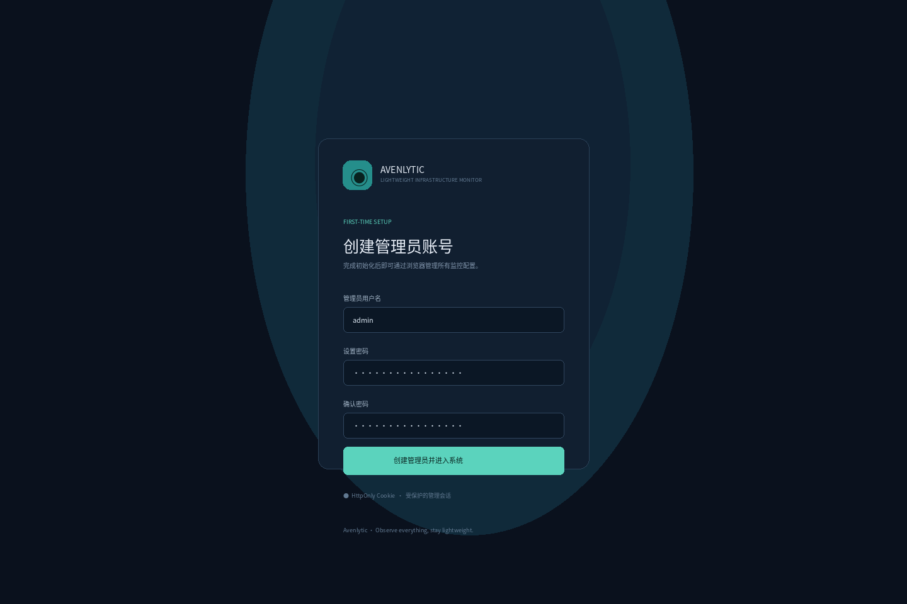
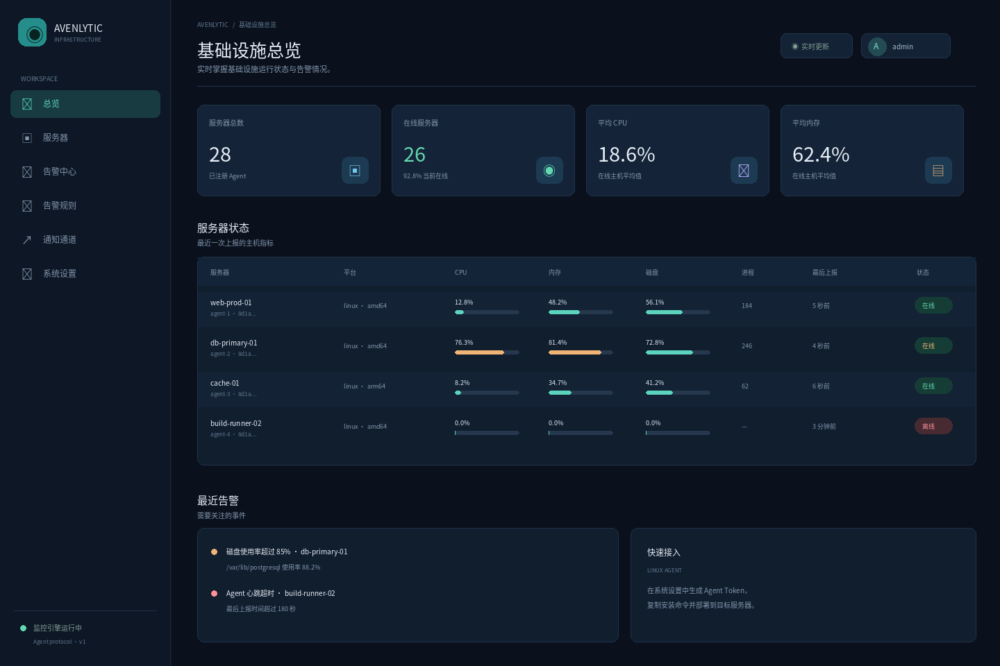
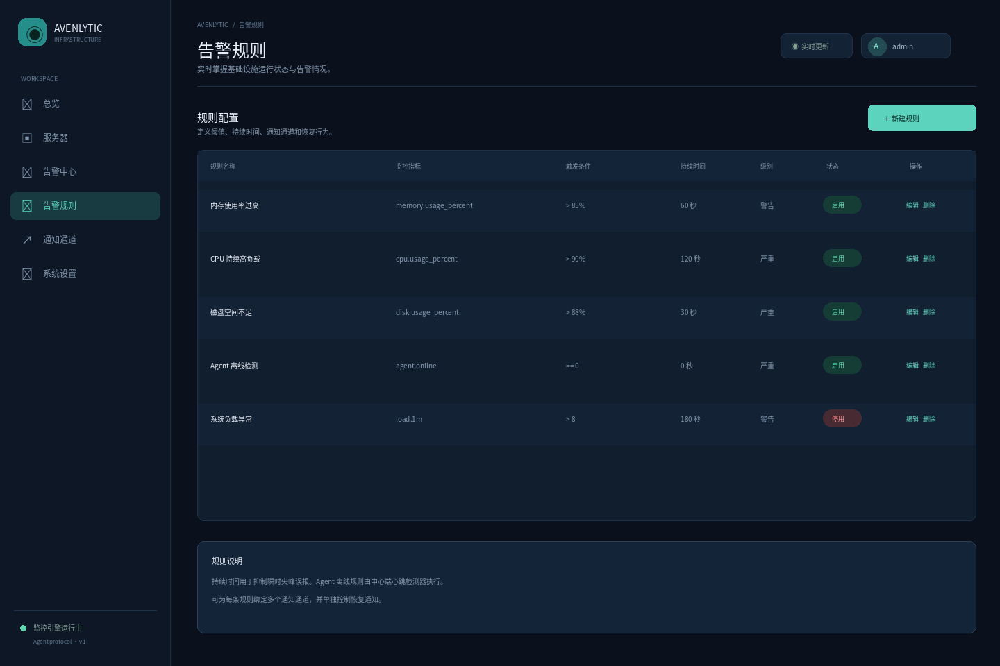
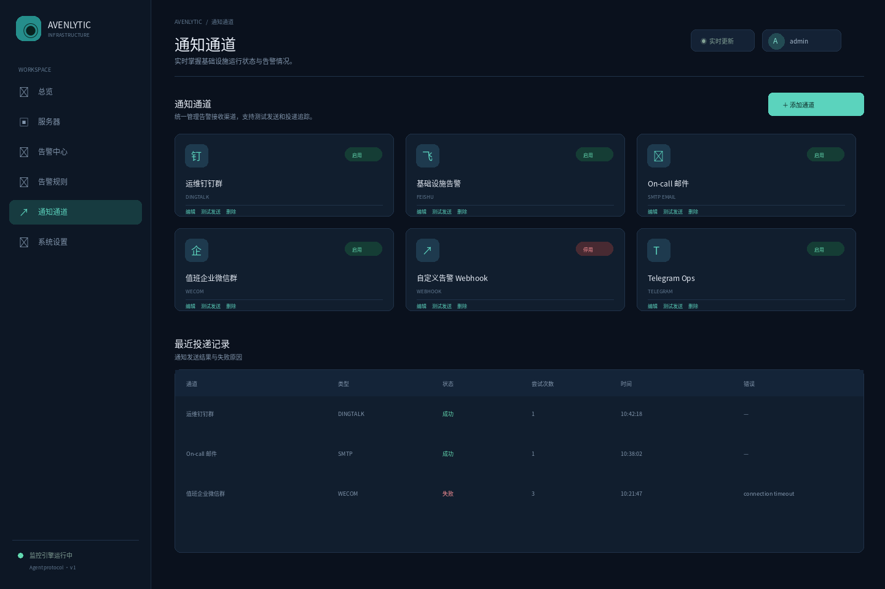
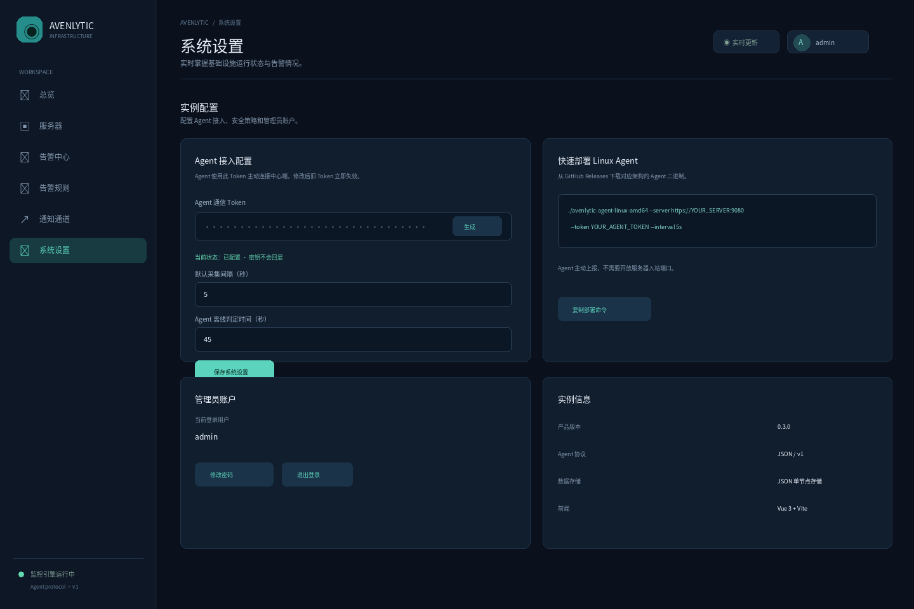

# Avenlytic

**轻量级、模块化、跨平台服务器监控系统。**

Avenlytic 使用 Go 开发，采用「轻量 Agent + 中心 Server + Web 控制台」架构。设计目标是低资源占用、主动上报、平台适配器解耦、告警与通知通道可扩展。

> **名称说明：** Avenlytic 是人为创造的品牌词，不是标准英语词典单词。它借鉴了 Analytics（分析）的语感，表达基础设施可观测与分析的产品定位。初步精确名称搜索没有发现明显的同名监控产品，但这不构成商标、公司名称、域名或 GitHub 名称的法律/注册查重。公开发布前仍需自行核查。

> **成熟度说明：** 当前仓库是具备真实运行能力的早期版本，不应宣传为已经达到 Zabbix/Prometheus 的生产级替代品。Linux 采集、Agent/Server 通信、告警规则、通知通道、投递记录和嵌入式 Web 控制台已实现；PostgreSQL、多用户 RBAC、持久化通知队列、远程配置下发，以及 Windows/macOS 原生采集仍需后续开发。

## 已实现功能

### Agent

- Go 单二进制，不需要 Node.js、Python、Docker 或其他运行时。
- 主动向中心端上报，支持 Bearer Token、可配置采集间隔、超时、指数退避和优雅退出。
- Linux Agent ID 默认从 `/etc/machine-id` 派生；也可使用 `--id` 指定。
- Linux 原生采集：
  - CPU 使用率、逻辑核心数。
  - CPU 型号/厂商、可用时的当前/最小/最大频率（`/proc/cpuinfo`、sysfs cpufreq）。
  - 可用的 hwmon 温度和风扇传感器。
  - 可选读取 cgroup v1/v2 挂载根目录的 CPU、内存、PID 和块 I/O 控制器统计。
  - 内存总量、已用、可用及使用率。
  - 1/5/15 分钟 Load Average、系统运行时间。
  - 网络接口 RX/TX 累计字节。
  - 支持文件系统的挂载容量、可用容量和使用率。
  - 块设备读写累计字节。
  - 进程数量、CPU 排名前 20 的进程、PID、状态、RSS。
  - Agent 自身 goroutine 和 Go Heap 使用量。
- Linux Agent 可选通过 `--docker-socket` 采集 Docker 容器清单与 CPU/内存用量，默认关闭。
- Linux Agent 支持 `--host-root` 容器化采集模式；只读挂载宿主根目录和 `/proc` 后，可采集宿主资源数据，无需 privileged、host PID 或 host network。
- 不支持或无法读取的指标不伪造为 0。
- 当前 Agent 通过平台 Snapshot 门面执行一次采集周期；`internal/core/collector` 和能力接口已建立独立采集器注册契约，下一阶段再把各指标拆分为独立调度任务。

### Server 与 Web

- Go `net/http` API，静态页面通过 `embed.FS` 嵌入服务端二进制。
- 生产管理后台采用 Vue 3 + TypeScript + Vite，构建后作为静态资源嵌入 Go Server；`cmd/server/web/` 提供无 Node.js 的开发回退控制台。
- 正式管理界面支持简体中文/英文切换与浅色/深色主题，选择保存在当前浏览器中。
- 管理员登录由服务端校验用户名和密码并签发 HttpOnly 会话 Cookie；浏览器后续请求携带 Cookie。浏览器会话保存在服务端内存中，服务重启后需要重新登录。API 客户端可通过 `POST /api/v1/auth/token` 获取 12 小时有效的 HS256 JWT，并在 Authorization 请求头中使用 Bearer 认证方案。签名密钥保存在状态文件中，修改管理员密码后会轮换密钥并使旧 JWT 失效。
- 服务器总览、在线/离线、CPU/内存平均值、服务器搜索和过滤。
- 主机详情：操作系统/发行版、架构、CPU 核心数、内存容量与可用量、系统负载、文件系统、网络累计流量、运行时长和进程。
- Docker 容器只读监控页：展示显式开启 Docker 采集的 Linux 主机上的容器、镜像及资源用量。
- 告警规则：CPU、内存、磁盘、1/5/15 分钟系统负载、进程数、主机心跳。
- 持续时间防抖、告警触发/确认/恢复状态。
- 通知通道配置、测试发送、投递记录和失败重试。
- 本地 JSON 原子持久化，适合开发、演示和小规模单节点部署。

### 通知通道

内置支持：

- SMTP 邮件。
- 钉钉机器人（支持签名）。
- 飞书机器人（支持签名）。
- 企业微信群机器人。
- Slack Incoming Webhook。
- Telegram Bot。
- 通用 JSON Webhook，可对接其他系统或自建通知网关。

通知模块使用 `notify.Channel` 接口和注册中心。新增渠道不需要修改告警规则引擎。

## 快速开始

要求 Go 1.27 或更高版本。

### 1. 编译

```bash
go test ./...
go build -trimpath -ldflags="-s -w" -o dist/avenlytic-server ./cmd/server
go build -trimpath -ldflags="-s -w" -o dist/avenlytic-agent ./cmd/agent
```

### 2. 启动中心端

```bash
./dist/avenlytic-server \
  --listen :9080 \
  --token '替换为高强度随机Token' \
  --data ./data/avenlytic.db
```

浏览器打开 `http://服务器地址:9080`。首次访问时，进入「系统设置」，填写与 Server 启动参数相同的 Token。

本地开发可以不传 `--token`，但这会关闭 API 认证，不能用于不可信网络。

### 3. 启动 Linux Agent

```bash
./dist/avenlytic-agent \
  --server http://服务器地址:9080 \
  --token '与中心端一致的Token' \
  --interval 5s
```

Agent 主动连接中心端，监控服务器不需要开放入站端口。生产环境必须使用 HTTPS，可通过反向代理提供 TLS。

如需启用只读 Docker 监控，显式传入 Unix Socket 路径，例如 `--docker-socket /run/docker-ro.sock`。控制台「Docker 容器」页面展示容器状态、镜像、端口、创建时间及可用资源用量。即使 Agent 只发送 GET 请求，Docker Socket 仍属于高权限接口；请使用仅放行所需只读 API 的受限代理。将 Socket 以只读文件系统方式挂载并不能阻止 Docker API 写操作。

### Docker 运行宿主 Agent

仓库默认 Compose 只启动中心 Server，容器中的 `/proc` 和根文件系统默认是容器自身，不能直接代表宿主。完成首次管理员设置并在控制台生成 Agent Token 后，将 Token 写入 `.env` 的 `AGENT_TOKEN`，然后运行：

```bash
docker compose --profile host-agent up -d --build
docker compose logs -f agent
```

此 profile 使用单独构建的轻量 Agent 镜像，将宿主 `/`、`/proc`、`/sys`、`/sys/fs/cgroup` 分别只读挂载到 `/host`、`/host/proc`、`/host-sys`、`/host-cgroup`，并传入 `--host-root /host --sys-root /host-sys --cgroup-root /host-cgroup`。Agent 以非 root 用户运行、移除全部 capabilities、启用只读容器根文件系统和 `no-new-privileges`；**不需要 privileged、`pid: host` 或 `network_mode: host`**。挂载表和网络接口从宿主 `/proc/1` 视图读取。除基础宿主指标外，还会采集可用的 CPU 型号/频率、hwmon/thermal 温度、风扇转速及 cgroup v1/v2 根目录 CPU、内存、PID、块 I/O 统计。Docker 递归只读子挂载要求 Linux Kernel 5.12 或更新版本；旧内核上宿主根目录下的子挂载可能仍可写，不要在旧内核上启用该 profile，建议在宿主直接运行 Agent。受 `hidepid`、LSM、rootless Docker 或宿主挂载可见性影响时，部分数据也可能缺失。该 profile 仅支持原生 Linux Docker；Docker Desktop 不提供通用的原生 Windows/macOS `/proc` 挂载，不能用它采集桌面宿主。

只读挂载仍会让 Agent 进程读取宿主根目录下该 UID 有权读取的文件；若不接受此访问范围，建议直接在宿主运行 Agent/systemd。宿主登录失败日志、软件包清单、系统更新检查和 systemd journal 查询不由容器 Agent 提供，请在宿主直接运行 Agent。Docker 容器清单则是另一个可选功能，需显式提供受限 Docker Socket 代理；可用 `docker-compose.agent-docker.yml` overlay 将代理 Socket 只读挂给 Agent，详见 [Docker 部署文档](docs/DEPLOYMENT_DOCKER.md)。Docker Socket 的文件只读挂载不限制 API 权限，直接挂载宿主 Docker Socket 相当于授予 Docker daemon 高权限访问。

完整挂载、安全边界、备份和发布说明见 [Docker 部署文档](docs/DEPLOYMENT_DOCKER.md)。

### 4. 配置告警和通知

1. 打开「通知通道」，添加 SMTP、钉钉、飞书、企业微信、Slack、Telegram 或通用 Webhook。
2. 点击「测试发送」，验证目标渠道。
3. 打开「告警规则」，例如设置 `memory.usage_percent > 85`，持续 60 秒。
4. 选择一个或多个通知通道，并决定是否在恢复时通知。
5. 如需 Agent 宕机告警，选择 `agent.online` 指标。中心端在 45 秒未收到心跳后开始判断，规则持续时间会额外增加防抖时间。

## 规则指标

| 指标 | 含义 | 当前支持 |
|---|---|---|
| `cpu.usage_percent` | CPU 使用率 | Linux |
| `memory.usage_percent` | 内存使用率 | Linux |
| `disk.usage_percent` | 最大挂载文件系统使用率 | Linux |
| `load.1m` | 1 分钟系统负载 | Linux |
| `load.5m` | 5 分钟系统负载 | Linux |
| `load.15m` | 15 分钟系统负载 | Linux |
| `process.count` | 可见进程数量 | Linux |
| `agent.online` | Agent 心跳状态 | Server 端 |

支持 `>`、`>=`、`<`、`<=`、`==`、`!=`。指标缺失时不参与阈值判断，不会被当作 0。

当前尚未采集登录失败记录、系统软件更新和公开漏洞匹配数据，因此暂不提供对应告警选项。此类能力需要新增主机采集器；漏洞匹配还需要维护可靠的漏洞公告来源。

## 命令行参数

Agent：

| 参数 | 默认值 | 说明 |
|---|---|---|
| `--server` | `http://127.0.0.1:9080` | 中心端地址 |
| `--token` | 空 | 必填 Bearer Token |
| `--interval` | `5s` | 采集/上报间隔，最小 1 秒 |
| `--name` | 系统主机名 | 主机显示名称 |
| `--id` | 自动派生 | Agent 稳定身份覆盖值 |
| `--docker-socket` | 空（关闭） | Linux Docker Engine Unix Socket 或受限 Socket 代理路径 |
| `--host-root` | 空（关闭） | Linux 容器 Agent 的宿主根目录挂载路径；同时要求其下有宿主 `/proc` |
| `--sys-root` | `/sys` 或 `<host-root>/sys` | sysfs 根目录；用于 CPU 频率和 hwmon 传感器 |
| `--cgroup-root` | `/sys/fs/cgroup` 或 `<host-root>/sys/fs/cgroup` | cgroup v1/v2 根挂载点；可用时采集控制器统计 |

Server：

| 参数 | 默认值 | 说明 |
|---|---|---|
| `--listen` | `:9080` | HTTP 监听地址 |
| `--token` | 空 | API/Agent Bearer Token；空值关闭认证 |
| `--data` | `data/avenlytic.db` | SQLite 数据库文件；首次启动会自动导入同目录下旧版 `avenlytic-state.json` |

## 架构规则

所有后续 AI 开发和人工贡献必须先阅读：

- [ARCHITECTURE.md](ARCHITECTURE.md)：架构边界与接口契约。
- [docs/DEVELOPMENT_RULES.md](docs/DEVELOPMENT_RULES.md)：AI 开发强制规则和任务流程。
- [docs/NOTIFICATIONS.md](docs/NOTIFICATIONS.md)：告警与通知模块扩展规范。

核心要求：

1. Core 不得导入 Linux/Windows/macOS 的具体实现。
2. 平台能力按接口拆分，新增平台只增加适配器、注册/构建组合和测试。
3. 不支持的能力必须明确不可用，不允许伪造指标。
4. Collector 不直接访问 `/proc`、WMI、Mach 或系统调用；通过平台 Provider 接口采集。
5. 通知渠道通过 `notify.Channel` 注册，不能把钉钉/邮件分支写进告警引擎。
6. Agent 默认只读，不增加远程 Shell 或任意脚本执行。
7. 所有网络调用必须有超时，重试必须有上限。

## 平台支持状态

当前 Linux 具有原生采集实现。Windows 和 macOS 有编译入口/适配器占位，但尚未实现原生 CPU、内存、磁盘、网络和进程采集。交叉编译通过不代表原生功能已完成。后续新增平台必须在真实操作系统上做集成测试。

Makefile 包含 Linux amd64/arm64、Windows amd64/arm64、macOS amd64/arm64 构建目标。执行 `make build` 会编译整套 Agent 矩阵和 Server，可能需要较长时间。

## 存储与生产部署说明

当前控制台展示最新快照及告警/投递历史；长期时序存储和历史趋势图尚未实现。当前使用 SQLite 单文件数据库、WAL 和事务，适合单实例部署；旧版 JSON 状态会在首次启动时导入 SQLite 并保留原文件。它不是高吞吐时序数据库，也不适合多 Server 实例并发写入。生产规模可基于 `storage.Repository` 接口增加 PostgreSQL 后端，并配套迁移、历史数据保留、聚合和备份。

SQLite 数据库包含 SMTP 密码、机器人 Token 和 Webhook 地址，必须限制文件访问权限并加密备份。生产部署还需要 HTTPS、独立 Agent 凭证、RBAC、审计、Webhook 出站白名单和通知持久化队列。

## 目录结构

```text
cmd/agent                 Agent 入口
cmd/server                Server 入口和嵌入式 Web
internal/core/model       跨平台指标模型与协议
internal/core/ports       平台能力接口
internal/core/collector   采集器契约与注册中心
internal/platform         平台选择和适配器
internal/core/ports 平台能力接口
internal/platform/linux   Linux 原生采集
internal/platform/windows Windows 占位适配器
internal/platform/darwin  macOS 占位适配器
internal/rules            告警规则
internal/notify           通知通道
internal/storage          存储接口和 SQLite Store
internal/server           API、告警生命周期和通知调度
cmd/server/web            Web 管理界面
configs                   配置示例
deployments/systemd       systemd 服务示例
docs                      架构、AI 开发和通知规范
```

## License

MIT，详见 [LICENSE](LICENSE)。

## v0.3 管理控制台、登录与 Docker 部署

- Web 管理后台正式前端源码位于 `web-ui/`，采用 Vue 3 + TypeScript + Vite。Docker 和 GitHub Actions 会先构建 Vue 静态资源，再将其嵌入 Go Server。`cmd/server/web/` 保留无需 Node.js 的开发回退界面；直接 `go run` 使用该回退界面，Docker/Release 产物使用 Vue 构建产物。
- 首次打开 Web 控制台时创建管理员账号；密码使用 PBKDF2-HMAC-SHA256（310,000 轮）加盐哈希保存。浏览器使用 HttpOnly、SameSite=Strict 会话 Cookie；管理员 API 不接受 Agent Token。可在系统设置启用随机安全链接，为 UI 和管理 API 增加入口校验；Agent 上报和健康检查不受影响。
- Agent Token 仅用于 `/api/v1/ingest`。可在「系统设置」中生成、轮换 Agent Token 和设置离线判定秒数；上报间隔由每台 Agent 的 `--interval` 参数配置，修改 Agent 参数后需重启对应进程。Token 不会从普通设置 API 回显；其值保存在服务端 SQLite 数据库中以支持重启恢复。
- 管理员可以在页面配置告警规则、通知通道、测试通知、查看投递历史、修改密码和退出登录。
- 轻量 Docker 单机部署：`docker compose up -d --build`，仅启动 Server，数据持久化在 `avenlytic-data` volume。首次访问 `http://HOST:9080` 完成管理员初始化；需要在 Docker 中监控宿主时，配置 `AGENT_TOKEN` 后使用 `docker compose --profile host-agent up -d --build`。
- `.github/workflows/ci.yml` 执行 Go race tests、vet、Vue build；`.github/workflows/release.yml` 在 `v*` Tag 上构建 Linux/Windows/macOS Agent 和 Server 二进制，并发布 linux/amd64、linux/arm64 GHCR Server 镜像 `ghcr.io/OWNER/REPOSITORY` 及 Linux Agent 镜像 `ghcr.io/OWNER/REPOSITORY-agent`。

详细步骤见 [Docker 部署文档](docs/DEPLOYMENT_DOCKER.md) 和 [AI 开发入口规范](docs/AI_DEVELOPMENT_PROMPT.md)。

## 界面预览

以下是项目界面设计预览图，使用演示数据，不代表线上实时数据。Vue 正式界面源码位于 `web-ui/`。







### Docker Hub 发布

Release 工作流会在配置 Docker Hub 凭据后，同时发布 `linux/amd64` 和 `linux/arm64` 镜像。请在 GitHub 仓库设置中添加：

- Repository variable：`DOCKERHUB_USERNAME`（Docker Hub 用户名或组织名）
- Repository secret：`DOCKERHUB_TOKEN`（Docker Hub Access Token，建议使用只读/读写范围受限的专用 Token）

镜像名为 `docker.io/<DOCKERHUB_USERNAME>/avenlytic`（Server）和 `docker.io/<DOCKERHUB_USERNAME>/avenlytic-agent`（Linux Agent），发布 Git tag 时推送对应版本标签和 `latest`。未配置用户名变量时，Docker Hub 发布任务会跳过；GHCR 发布不受影响。

部署时可在 `.env` 中设置 `AVENLYTIC_IMAGE=docker.io/<用户名>/avenlytic:latest` 和 `AVENLYTIC_AGENT_IMAGE=docker.io/<用户名>/avenlytic-agent:latest`，然后执行 `docker compose pull && docker compose up -d`。
